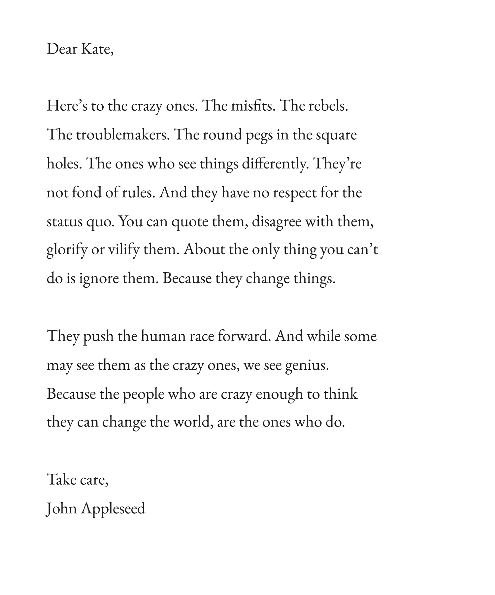
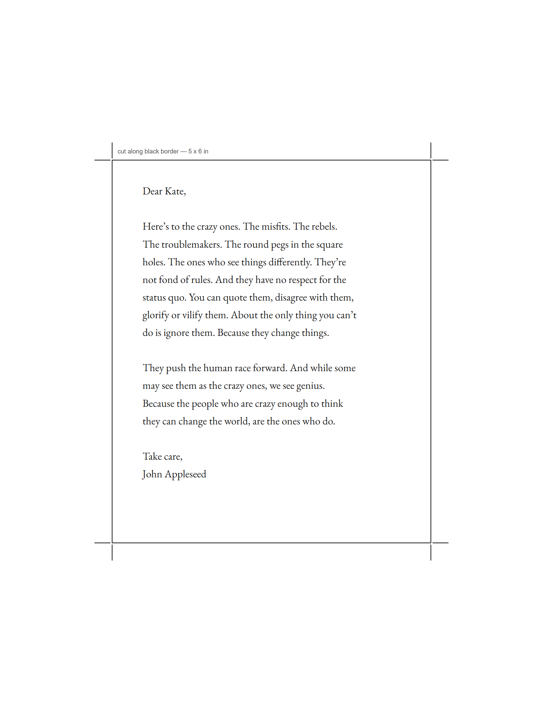
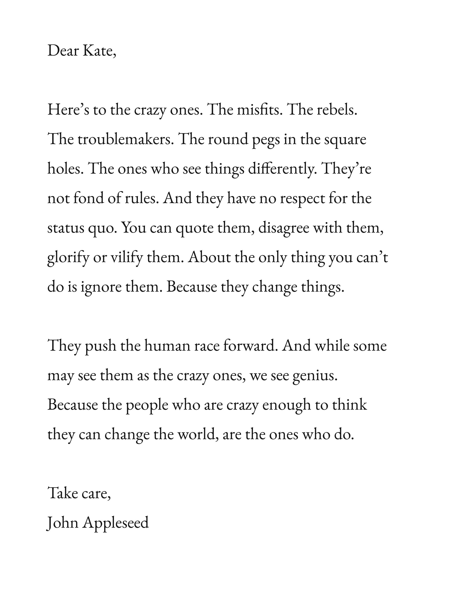
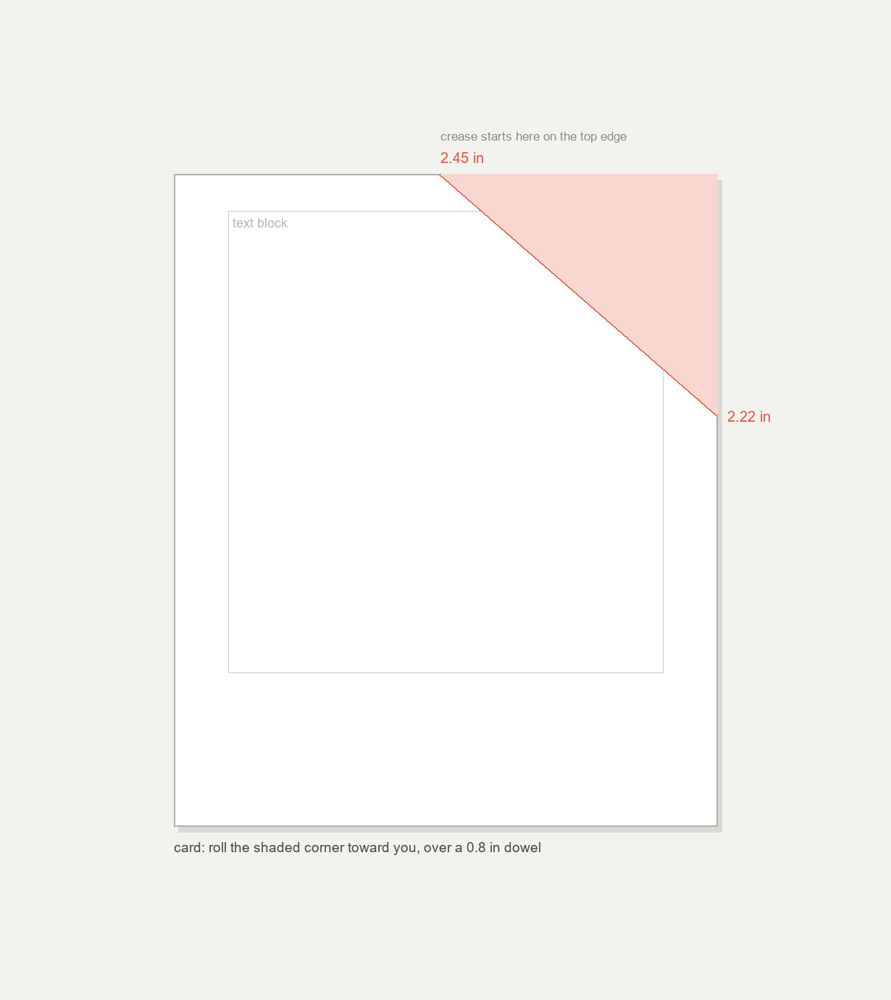

# The Appleseed Letter

A physical replica of Apple's TextEdit icon. Same words, same type, same sheet, with a real rolled corner.


## Contents

- [What this is](#what-this-is)
- [Print me](#print-me)
- [Gallery](#gallery)
- [The text](#the-text)
- [Typography](#typography)
- [Paper and printing](#paper-and-printing)
- [The curl](#the-curl)
- [Display it](#display-it)
- [Build order](#build-order)
- [Rebuild from source](#rebuild-from-source)
- [Files](#files)
- [Notes and limits](#notes-and-limits)

## What this is

This is not a photo of a document. It is Apple's TextEdit app icon, the version that shipped from Mac OS X 10.5 Leopard (2007) through 10.9 Mavericks. Blow the icon up in Finder and the "paper" turns out to have a letter printed on it.[^1]

The text is the Think Different manifesto, written by Rob Siltanen and Ken Segall at TBWA Chiat Day in 1997 and read by Richard Dreyfuss. The icon carries a cut down version: two paragraphs instead of the ad's five, with "They push the human race forward" moved up to open the second one.

John Appleseed is Apple's stand-in name for a demo user, the same reason every sample contact is John Appleseed. Kate is generally read as the KDE text editor Kate, so it is an editor writing to another editor. In 10.10 Yosemite the letter was replaced with a blank sheet and a pen. The letter only existed from 2007 to 2014, which is why the icon is a small piece of Mac lore.

<details>
<summary>Why three sizes</summary>

There is no single correct size, because the icon was never a real document. It is 5:6, not Letter (1.29) or A4 (1.41), and its type is about 7 px tall. Scale it 1:1 to Letter and the type lands near 23 pt. Keep normal 12 pt type on Letter and the text only fills the top third.

Also, the curl covers the ends of the first three lines in the icon. A faithful replica hides the same words. That is the point, but it means the card build is not fully readable once curled.

So this repo ships three: card (icon proportions), sheet (same layout at life size), and letter/A4 (a normal letter you could hand someone).

</details>

> [!IMPORTANT]
> Print at 100 percent (Actual size) with no scaling and no header or footer, or the geometry below will not hold.

## Print me

| File | Size | For |
|:-----|:-----|:----|
| [`out/appleseed-letter_card.pdf`](out/appleseed-letter_card.pdf) | 5 x 6 in | the replica, icon proportions |
| [`out/appleseed-letter_card-trim.pdf`](out/appleseed-letter_card-trim.pdf) | Letter sheet, 5 x 6 card centered | print on US Letter, cut along the line |
| [`out/appleseed-letter_sheet.pdf`](out/appleseed-letter_sheet.pdf) | 8.5 x 11 in | same layout at life size, framable |
| [`out/appleseed-letter_letter.pdf`](out/appleseed-letter_letter.pdf) | 8.5 x 11 in | a normal 14 pt letter |
| [`out/appleseed-letter_a4.pdf`](out/appleseed-letter_a4.pdf) | 210 x 297 mm | same as letter, on A4 |

```bash
# one evening, under an hour of hands-on work
1. print card-trim at 100 percent .... 10 min
2. check density, cut along border ....  5 min
3. curl the corner (see below) ........ 10 min
4. mount or photograph ............... 20 min
```

> [!TIP]
> Print two copies on the good stock. Curl one, keep one flat as a control.

## Gallery

The replica (card, 5 x 6 in):



Trim version (Letter sheet, cut along the border):



Life size (sheet, 8.5 x 11 in):



Crease geometry (card):



## The text

> Dear Kate,
>
> Here's to the crazy ones. The misfits. The rebels. The troublemakers. The round
> pegs in the square holes. The ones who see things differently. They're not fond
> of rules. And they have no respect for the status quo. You can quote them,
> disagree with them, glorify or vilify them. About the only thing you can't do is
> ignore them. Because they change things.
>
> They push the human race forward. And while some may see them as the crazy ones,
> we see genius. Because the people who are crazy enough to think they can change
> the world, are the ones who do.
>
> Take care,
> John Appleseed

<details>
<summary>Other wordings out there</summary>

The 1997 print and TV version reads "disagree with them, disbelieve them" (the icon drops "disbelieve") and includes the "They invent. They imagine. They heal." paragraph. Older low-res icons run longer lines: "You can praise them, disagree with them, quote them, disbelieve them..." This build follows the icon.

To change the wording, edit LETTER in build.py.

</details>

## Typography

Measured off the reference (ink bounding box as a percent of the page):

| Property | Icon | card | sheet |
|:---------|-----:|-----:|------:|
| Top of block | 6.5% | 7.1% | 7.2% |
| Block height | about 81% | 79.9% | 80.0% |
| Left margin | 9.4% | 9.2% | 9.7% |
| Block width | about 70% | 67.2% | 72.4% |
| Bottom margin | 12.9% | 12.9% | 12.8% |

The card is 12 pt on 21 pt leading. The sheet is 22 pt on 38 pt. Small type with loose leading, which is most of the look. About 59 characters per line. Left aligned, ragged right, no hyphenation, blank line between paragraphs. Color is near black (card #1b1b1b, sheet #141414), not full K, so it reads soft like the icon but still prints dark. Apostrophes are proper curly quotes, checked in the PDF text layer. The line breaks are fixed to the icon's: all 14 text lines break on the same words, checked by extracting the PDF text and diffing it against the transcription.

The face is EB Garamond, regular, embedded in the PDFs (open source, SIL license, shipped in `fonts/`). I landed there by measuring the icon at the pixel level: stems flare into small feet top and bottom with thick-thin contrast and no slant, so serif and upright, and at matched x-height EB Garamond renders the icon's lines at exactly the icon's width (173 px on the test line) where Times runs 9 px wide and Arial 30 px wide. The letter and A4 variants stay in Times New Roman, since those are meant as ordinary correspondence, not replicas. If you want to swap faces, set `font` in VARIANTS and rebuild.

## Paper and printing

The icon's sheet is flat, bright white, matte, a touch warm. Photocopier white, not cream. Match that.

| Layer | What to get | Why |
|:------|:------------|:----|
| Paper | Uncoated, 100 to 120 gsm (24 to 32 lb), smooth, laser rated, 96 to 100 brightness | Holds 12 pt type crisply and still takes a curl |
| Avoid | 80 gsm office paper (too floppy), 270 gsm card (will not curl), coated or glossy (cracks on a roll) | |
| Ink | Full black toner from a laser, or pigment black inkjet | Toner sits on the surface, sharpest small type |
| Grain | Long grain, and curl with the grain | Rolls smooth, holds the set |

Stocks that behave: Mohawk Superfine Eggshell White 100 lb text, Neenah Classic Crest Solar White 80 lb, Southworth 32 lb (home), HP Premium32 120 gsm (home).

Best options in order. A print shop with a 1200 dpi digital laser, on your own 100 lb stock, asking for black only at 100 percent, runs a few dollars. A home laser on 32 lb paper with the driver on best and fit-to-page off is nearly as good. Inkjet on matte paper with quality maxed is fine at 12 pt on the card, softer on the big sheet. Letterpress from a polymer plate is the nicest and by far the most expensive way to do it.

> [!WARNING]
> Do not print a paper texture or a fake shadow into the file. The object itself supplies both. And never run inkjet glossy or photo paper through a laser printer, the coating melts.

## The curl

This is the part that makes it read as the icon. The crease runs from 49 percent of the width along the top edge to 37 percent of the height down the right edge. On the card that is 2.45 in in from the top left, ending 2.22 in down the right edge. On the sheet it is 4.17 in and 4.07 in. The curl guide images show it dimensioned.

Method A, dry roll (start here, it is reversible). Lay the sheet face down on something clean and hard. Put a 1 in dowel or rolling pin diagonally under the corner. Wrap the corner over the dowel and press it flat with your palm for ten seconds. Release, rotate the dowel 90 degrees, roll again. Three or four passes in slightly different directions give the paper a curved memory instead of a crease. Finish tighter at the tip so it tapers the way the icon's does.

Method B, moisture set (permanent but still reversible). Mist the back of the corner very lightly with a damp sponge, not a spray. Roll it, clip the roll to the dowel with a binder clip, and let it dry ten to fifteen minutes. Paper shrinks as it dries and locks the curve in. Test on scrap first, too much water leaves marks on uncoated stock.

Method C, steam (crispest). Two seconds over a kettle spout, then roll and clip. Same idea as B, faster, easier to overdo.

> [!TIP]
> A half drop of PVA glue under the underside of the roll is invisible and stops it relaxing. An hour under a weight works too. If you want the whole letter readable, roll only a 1 in corner instead. Same gesture, nothing hidden.

## Display it

Float it on eighth inch foam board with two Japanese tissue hinges on the back (archival, removable), or stand it on a small clear acrylic easel. If you frame it, use a shadow box at least 1 in deep. A standard frame will flatten the curl and undo the work.

Light it with one soft source from the upper left at 45 degrees, big and diffused. The icon's whole look is that soft shadow under the curl, and hard light kills it. For photos, white sweep, camera slightly above center tilted down about 15 degrees, expose for the paper rather than the shadow.

## Build order

- [x] Reference measured, text transcribed, geometry matched
- [x] PDFs built with embedded Times, exact page boxes, curly quotes
- [x] Proofs rendered and read back, trim and curl guides drawn
- [ ] You: print, cut, curl, mount or photograph

## Rebuild from source

```bash
python build.py --measure      # all variants plus geometry report
python build.py card           # one variant: card, card-trim, sheet, letter, a4
python curl_guide.py           # redraw the crease diagrams
```

You need Python 3 and Chrome (it is the PDF engine, so typefaces embed exactly). Pillow is only for the proof renders.

## Files

```text
build.py                            HTML to PDF engine (headless Chrome, exact page boxes)
curl_guide.py                       crease diagrams
fonts/EBGaramond.ttf + OFL.txt      the replica face, embedded in the PDFs
out/appleseed-letter_card.pdf       5 x 6 in, icon proportions, the replica
out/appleseed-letter_card-trim.pdf  Letter sheet with cut guides and crop marks
out/appleseed-letter_sheet.pdf      8.5 x 11 in, same layout at life size
out/appleseed-letter_letter.pdf     8.5 x 11 in, normal 14 pt letter
out/appleseed-letter_a4.pdf         A4, same as letter
out/curl-guide_*.png                dimensioned crease geometry
out/pdf-proof_*.png                 renders of the actual PDFs
```

## Notes and limits

Font certainty: the words, breaks, proportions, alignment, leading, and ink are measured from the reference, and the Garamond-style face is confirmed by pixel measurement plus a glyph check of the finished PDF. See Typography.

Copyright: the manifesto is Apple's 1997 ad copy. Fine as a personal replica, do not sell it.[^2]

One fidelity quirk: the icon's own text is cut off by the curl. If you curl yours as specified, it hides the same words. That is not a bug. Keep the flat print if you want to read it.

[^1]: Wikipedia: [TextEdit](https://en.wikipedia.org/wiki/TextEdit). "The high-resolution TextEdit 1.5 icon found in Mac OS X versions starting with 10.5 (Leopard) features an extract from Apple's 'Think different' ad campaign."
[^2]: Text by Rob Siltanen and Ken Segall, TBWA Chiat Day, 1997. This project recreates the icon's condensed arrangement for personal and educational use.
